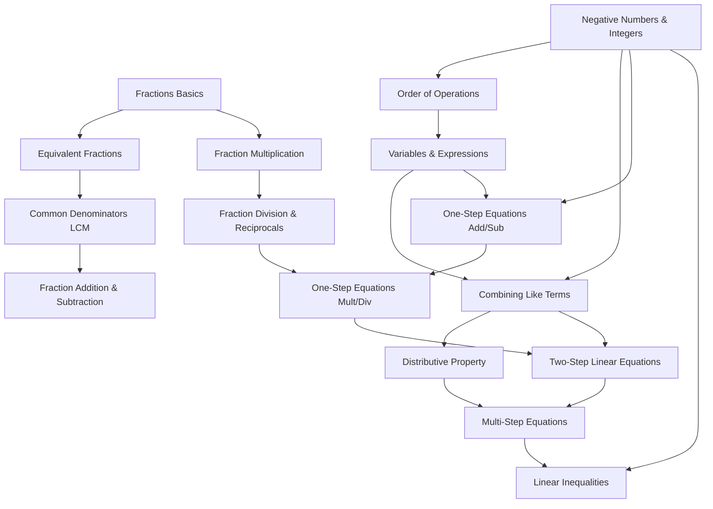

# Cognify — AI Learning-Gap Detection Tutor Backend

A high-performance **FastAPI + SQLite** backend for an AI learning-gap detection tutor. It integrates **Bayesian Knowledge Tracing (BKT)** with a **NetworkX Prerequisite Concept Graph** (from fractions to linear algebra) to track mastery and diagnose foundational root gaps when students struggle.

---

## Key Highlights

- **16-Concept Prerequisite Graph (DAG)**: Formulated in [concepts.json](file:///data/concepts.json) and managed via NetworkX (`nx.DiGraph`), spanning Fractions Basics up to Linear Inequalities with acyclic validation.
- **Pedagogical MCQ Question Bank**: 64 multi-choice questions in [questions.json](file:///data/questions.json) (4 per concept). **Every incorrect option is tagged with an explicit cognitive misconception label** (e.g., `add_denominators_directly`, `evaluated_left_to_right_without_precedence`, `forgot_to_flip_inequality_sign`).
- **Bayesian Knowledge Tracing (BKT) Engine**: Standard 4-parameter formulation tracking $P(\text{known})$ per student per concept in SQLite:
  - $P(L_0) = \text{init} = 0.30$
  - $P(T) = \text{learn} = 0.20$
  - $P(S) = \text{slip} = 0.10$
  - $P(G) = \text{guess} = 0.25$
- **Root-Gap Detection**: When a student fails a question, the engine traverses the prerequisite DAG upstream via topological ancestry, isolates the weakest unmastered prerequisite ($P < 0.65$), reconstructs the dependency pathway, and issues targeted remediation.
- **Cohort Seed Script**: Populates SQLite with **30 simulated students across 5 distinct learning personas** (Advanced Achievers, Fraction Strugglers, Negative Number Confused, Hidden Gap Learners, Beginners) generating 600 realistic attempts.
- **Interactive Web Dashboard**: Built-in glassmorphic UI served directly at `http://127.0.0.1:8000/` featuring live student practice, class-wide 30×16 mastery heatmap, misconception frequency rankings, and curriculum graphs.
- **Comprehensive Test Suite**: 22 unit & integration tests covering BKT math, DAG traversal, root-gap isolation, and all FastAPI endpoints.

---

## Mathematical Formulation: Bayesian Knowledge Tracing (BKT)

### 1. Observation Update (Bayes' Rule)
Given prior mastery $P(L_t)$:

- **Correct Answer ($obs = 1$):**
  $$P(L_t \mid obs=1) = \frac{P(L_t) \cdot (1 - P(S))}{P(L_t) \cdot (1 - P(S)) + (1 - P(L_t)) \cdot P(G)}$$

- **Incorrect Answer ($obs = 0$):**
  $$P(L_t \mid obs=0) = \frac{P(L_t) \cdot P(S)}{P(L_t) \cdot P(S) + (1 - P(L_t)) \cdot (1 - P(G))}$$

### 2. State Transition (Learning Step)
$$P(L_{t+1}) = P(L_t \mid obs) + \big(1 - P(L_t \mid obs)\big) \cdot P(T)$$

---

## Prerequisite Concept Graph (DAG)



---

## API Endpoints

| Method | Path | Description |
|---|---|---|
| `POST` | `/answer` | Submit answer, update BKT $P(\text{known})$, detect misconception & root gap, generate LLM insight |
| `GET` | `/next-question/{student_id}` | Adaptive question recommendation targeting root gap or ZPD |
| `GET` | `/mastery/{student_id}` | Complete mastery profile across 16 concepts & active gaps |
| `GET` | `/class-heatmap` | 30×16 cohort mastery matrix with concept difficulty metrics |
| `GET` | `/misconceptions` | Cohort-wide misconception frequencies & concept breakdowns |
| `GET` | `/misconceptions/cached` | Inspect SQLite-cached LLM misconception explanations |
| `GET` | `/concepts` | Graph topology nodes & directed prerequisite edges |
| `GET` | `/health` | API health check & data statistics |
| `GET` | `/` or `/dashboard` | Interactive Web Dashboard |

---

## Project Structure

```
Cognify/
├── app/
│   ├── bkt.py               # Pure BKT engine with Bayesian update formulas
│   ├── concept_graph.py     # NetworkX DAG management & ancestor search
│   ├── config.py            # Global parameters, file paths & thresholds (.env loader)
│   ├── database.py          # SQLite schema, transactions, helper queries & cache tables
│   ├── gap_detector.py      # Upstream DAG traversal & weakest prerequisite finder
│   ├── llm_tutor.py         # LLM-powered misconception explanation generator & multi-tier cache
│   ├── main.py              # FastAPI application & endpoint definitions
│   ├── models.py            # Pydantic schemas for request/response validation
│   ├── recommendation.py    # ZPD & root-gap question selector
│   └── static/
│       └── index.html       # Glassmorphic Interactive Dashboard
├── data/
│   ├── concepts.json        # 16 math concepts with prerequisite definitions
│   ├── questions.json       # 64 MCQs with tagged misconception labels
│   └── tutor.db             # SQLite database
├── frontend/                # React 19 + TypeScript + Vite adaptive frontend
├── scripts/
│   ├── seed_data.py         # Seeds 30 simulated students across 5 personas
│   └── verify_api.py        # Verification script for endpoints
├── tests/
│   ├── test_api.py          # FastAPI endpoint integration tests
│   ├── test_bkt.py          # Unit tests for BKT update math & convergence
│   ├── test_llm_tutor.py    # LLM generation, fallback, and caching tests
│   └── test_root_gap.py     # DAG traversal & root-gap detection tests
├── .env.example             # Template for GEMINI_API_KEY / OPENAI_API_KEY
├── requirements.txt
└── README.md
```

---

## Getting Started

### 1. Setup Virtual Environment & Install Dependencies
```bash
python -m venv .venv
.venv\Scripts\pip install -r requirements.txt
```

### 2. Seed Database
```bash
.venv\Scripts\python scripts/seed_data.py
```

### 3. Run Test Suite
```bash
.venv\Scripts\pytest -v
```

### 4. Start Backend Server
```bash
.venv\Scripts\uvicorn app.main:app --host 127.0.0.1 --port 8000
```

### 5. Start React + TypeScript + Vite Frontend
```bash
cd frontend
npm run dev
```
Open **`http://localhost:5173`** for Vite live-reload, or **`http://localhost:8000`** to view the production-built React app served directly by FastAPI.

---

## Frontend Architecture (React + TypeScript + Vite)

- **Interactive Adaptive Quiz Screen** ([QuizScreen.tsx](file:///frontend/src/components/QuizScreen.tsx)):
  - Dynamically fetches next question matching the student's Zone of Proximal Development (ZPD) or targeted root-gap prerequisite.
  - Interactive MCQ option selection with instant evaluation.
  - **Misconception Diagnosis**: Explicitly tags and explains cognitive misconceptions (e.g. `add_denominators_directly`, `forgot_to_flip_inequality_sign`).
  - **Dynamic BKT Posterior Delta**: Displays live mastery transition ($P(L_t) \to P(L_{t+1})$) with percentage gains/losses.
  - **Prerequisite Root-Gap Chain**: Traces the dependency path upstream to the weakest unmastered prerequisite when errors occur.
- **Interactive Knowledge-Graph Explorer** ([KnowledgeGraphExplorer.tsx](file:///frontend/src/components/KnowledgeGraphExplorer.tsx)):
  - 16 math concepts rendered in pedagogical DAG layout.
  - **Nodes dynamically colored by Bayesian mastery level $P(\text{known})$**:
    - 🟢 **Mastered ($\ge 85\%$)**: Emerald
    - 🔵 **Proficient ($65-84\%$)**: Cyan/Teal
    - 🟡 **In-Progress ($40-64\%$)**: Amber
    - 🔴 **Critical Gap ($< 40\%$)**: Crimson/Rose
  - **Active Root Gap Edge Lighting**: Prerequisite bottlenecks glow with dashed amber/crimson connectors.
  - Interactive inspection drawer with direct prerequisites, downstream dependents, and "Practice this Concept" action.
- **Dark Theme and White (Light) Theme**:
  - Controlled by [ThemeContext.tsx](file:///frontend/src/context/ThemeContext.tsx) and persistent via `localStorage`.
  - Seamless CSS variable switching with curated palettes, glassmorphism, and responsive typography.
- **Class Mastery Heatmap & Misconception Leaderboard**:
  - Full 30×16 student cohort matrix with cohort statistics.
  - Aggregated misconception frequency leaderboard guiding teacher interventions.

